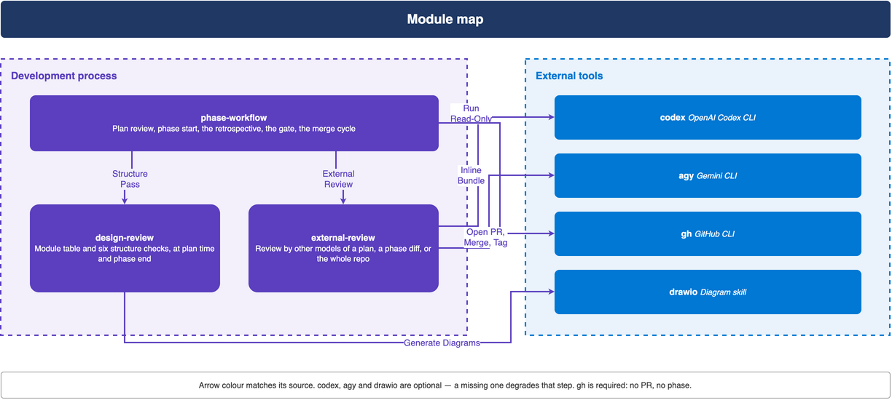

# Architecture

How `localclaude` is put together today. Planned work is in
[ROADMAP.md](ROADMAP.md); what already shipped is in [CHANGELOG.md](../CHANGELOG.md).

## What this is

A Claude Code plugin of eight skills. Each exposes a `SKILL.md` that Claude reads and follows.
Shell helpers implement setup, review capture, reviewer preflight, mutation restoration and
release checks. Python helpers handle reviewer deadlines, roadmap edits and design-review test
tooling. `docs/build_architecture.py` generates the module diagram.

There is no application entry point. A module here is a skill directory, with an invocation
as its interface. Verification covers both executable behavior and agreement between the
instructions and the commands they tell a reader to run.



Regenerate the diagram from its source rather than editing the XML:

```bash
python3 docs/build_architecture.py
python3 ~/.claude/skills/drawio/scripts/validate.py docs/architecture.drawio
python3 ~/.claude/skills/drawio/scripts/render_png.py docs/architecture.drawio
```

## Module table

Ordered most-stable-first: what sits at the top changes only when the user changes their mind,
what sits at the bottom changes when someone else ships a new CLI.

| Unit | Responsibility | Interface | Depends on |
| --- | --- | --- | --- |
| `phase-workflow` | Run a phase from plan review to merge | `/localclaude:phase-workflow` | `design-review`, `external-review`, `gh` |
| `design-review` | Decide structure at plan time and re-check it at phase end | `/localclaude:design-review <plan\|phase>` | `drawio` skill |
| `claude-setup` | Configure a machine and keep the standards block current | `/localclaude:claude-setup` | `~/.claude`, Drive |
| `project-env` | Build or repair a project env outside Drive | `/localclaude:project-env` | `standardize-*-envs.sh`, uv, npm |
| `drive-backup` | Copy transcripts, plans, memory and config to Drive | `/localclaude:drive-backup`, the `Stop` hook | `backup-projects.sh`, rsync, Drive |
| `external-review` | Get a non-Claude review of a plan, a phase diff or the repo | `/localclaude:external-review <plan\|phase\|repo>` | `codex`, `agy` |
| `local-models` | Find, size and fetch local models | `/localclaude:local-models` | `huggingface-skills`, HF |
| `claude-toggle-backend` | Point Claude Code at a different inference backend | `/localclaude:claude-toggle-backend <backend>` | `~/.claude/settings.json`, local servers |

**Expected change:** a new external reviewer. Adding one edits `external-review`, and today
also `phase-workflow`, which names the reviewer pair in its skip rules — that second edit is the
coupling to remove if this expectation is to hold.

**Shared state:** `~/.claude/settings.json` has three writers — `claude-setup` (the permission
allowlist), `claude-toggle-backend` (model, effort and `ANTHROPIC_*` keys) and `drive-backup`
(the `Stop` hook). It is the only shared mutable state in the repo, and the reason a writer
must patch keys in place rather than rewrite the file. `toggle.sh` does not — it rewrites the
whole document, which is KI-01.

`~/.zshrc` is the other shared file, and it is shared differently: one writer in the repo,
`claude-toggle-backend`, plus one surface the repo depends on and does not own. `phase-workflow`
called a hand-written `git-clean-local-branches` function until §4 inlined it, so that dependency
is gone; what remains is an `HF_HOME`
block branded `# >>> localclaude` exports a variable no skill installs (KI-16). Marker text
asserts an owner, so the question to ask of a block in that file is whether code generates it,
not whether it looks managed. KI-22 is the truncation bug in the block that did move here.

## The three groups

**The development process** — `phase-workflow` orchestrates; `design-review` and
`external-review` are called by it at defined points and are useful on their own. The
dependency is mostly one way: `external-review repo` runs on a repository that has never seen
a phase. It is not clean, though — both sub-skills reference workflow stages by number and
`phase-workflow` names the reviewer pair, so the three are more coupled than the call graph
suggests.

**Machine configuration** — `claude-setup` owns `~/.claude`. Its global standards live in a
marked block that a re-run reconciles, so every machine converges on the same text. The
canonical copy is in `claude-setup/SKILL.md`, and the installed file must match it
byte-for-byte inside the markers.

`project-env` and `drive-backup` sit beside it, each holding a procedure `claude-setup` used to
carry inline. `project-env` took the environment steps out of the standards block on one test:
**a prohibition stays resident, a procedure moves to a skill.** "No virtualenv ever lives inside
Drive" is something you need before you know you need it, so it stays in the block; the argument
order of `standardize-python-envs.sh` is not, so it moved.

`drive-backup` took the transcript backup out of `claude-setup` on a different test — one
concern, one owner. Backing conversations up to Drive is a separate product that happened to be
installed by the same run, with its own script, its own bug cluster and its own upcoming phase.
What is left in `claude-setup` step 6 is a pointer plus the one fact the caller needs: both
skills write `settings.json`, so whichever runs second must merge.

`claude-setup` writes `~/.claude/`, the top-level `~/.claude.json`, `~/.markdownlint.jsonc`,
the two Drive symlinks, and Homebrew packages. Its `~/.zshrc` block went to
`claude-toggle-backend`, which is the skill those aliases control, and it offers the VS Code
parity step rather than performing it — so it touches neither the shell nor the editor.
`claude-setup` step 6 invokes `drive-backup` to install backups. `project-env` is invoked
directly when a project environment is set up or repaired.

**Local backends** — `claude-toggle-backend` switches which server Claude Code talks to and
`local-models` decides which model that server should load. Both are being rebuilt, so their
open issues are held rather than worked; see the Held sections in
[KNOWN_ISSUES.md](KNOWN_ISSUES.md) and [ENHANCEMENTS.md](ENHANCEMENTS.md).

## External tools are all optional

`codex`, `agy` and the `drawio` skill are each invoked by exactly one skill, and a missing one
degrades that step rather than blocking the workflow. **`gh` is the exception and is required.** `external-review` reports its
[coverage classification](../skills/external-review/SKILL.md#coverage-classification); `design-review` records "no diagram" and carries on. `gh` is the closest to
required — `phase-workflow` cannot open or merge a PR without it — so it is preflighted before
the first phase-start mutation rather than discovered at merge time.

The reviewers are also the one place this repository sends its own source to a third party.
The bundle procedure in `external-review` excludes credential-shaped files, skips symlinks
before reading them, and disables diff conversion filters, in every mode.

## Testing

`claude-toggle-backend/tests/` holds the `bats` suite: 29 tests with fakes for `curl`,
`uname` and `vllm-mlx` and a sandboxed `$HOME`. Eight of them pass with the behaviour they
name removed — see UNK-02.

The process and setup suites run against scratch repositories and temporary directories:

| Skill | Executable checks |
| --- | --- |
| `claude-setup` | standards installation, link installation, README installation command |
| `external-review` | bundle capture, pruned export, documented Codex invocation, preflight |
| `phase-workflow` | mutation restoration, release checks, documented release and cleanup commands, roadmap edits, reference verification, bats assertion enumeration |
| `design-review` | transcript handling, fixture evaluation, Results writer, rollup tooling |

Run them with:

```bash
bats skills/claude-setup/tests skills/external-review/tests skills/phase-workflow/tests skills/design-review/tests
```

The canaries include excluded content, user configuration, uncommitted work and unrelated table
cells. All tests in these suites must pass; none is intentionally left red. `project-env` owns
instructions for scripts outside this repository and currently has no bundled Bats suite.

`drive-backup`'s `backup-projects.sh` has no tests at all. That is ENH-03, and the next phase.

The skills themselves are prose, so they are tested by running scenarios against a fresh
agent: `design-review/tests/` holds seven, each with failure conditions written to judge the
design an agent *produces* rather than what it says about it.
